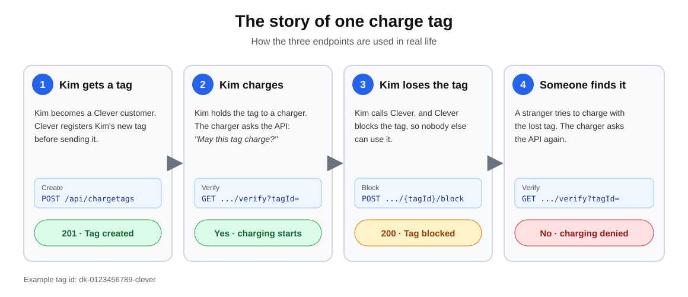
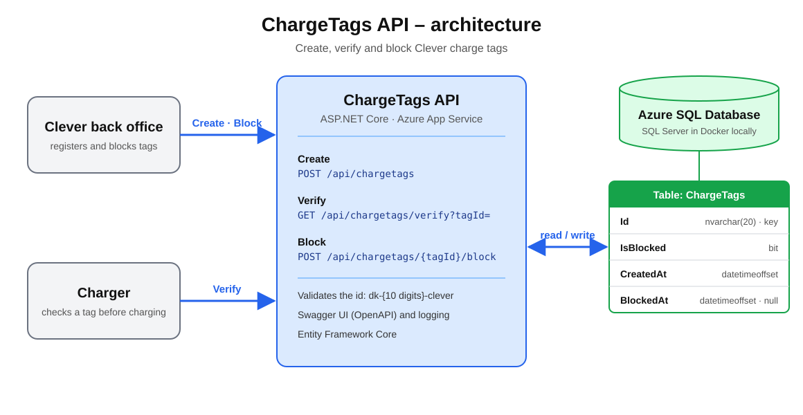

# ChargeTags API

A .NET API for managing Clever charge tags: create a tag, verify that it can be used for charging, and block it so it can no longer be used. A charge tag is identified by an id in the format `dk-{10 digits}-clever`.

## The story



Kim has just bought an electric car and becomes a Clever customer. Before Kim's new charge tag is sent, Clever registers it in the system (**Create**).

When Kim holds the tag to a charger, the charger asks the API whether the tag may be used. The tag exists and is not blocked, so charging starts (**Verify**).

One day Kim loses the tag and calls Clever, who blocks it (**Block**). When someone else later tries to charge with the lost tag, Verify answers that it is blocked, so nobody can charge on Kim's account.

## Architecture



| Endpoint | Request | Responses |
|---|---|---|
| Create | `POST /api/chargetags` with `{ "tagId": "dk-0123456789-clever" }` | `201` created, `400` invalid id, `409` already exists |
| Verify | `GET /api/chargetags/verify?tagId=dk-0123456789-clever` | `200` with `exists`, `isBlocked` and `canCharge`, `400` invalid id |
| Block | `POST /api/chargetags/dk-0123456789-clever/block` | `200` blocked, `400` invalid id, `404` not found |

## Try it

Swagger UI in Azure: https://app-chargetags-9496.azurewebsites.net/swagger

The first request after a quiet period can take a little longer, because the free App Service plan and the serverless database wake up on demand.

## Run locally

Requires the .NET 10 SDK and Docker.

```bash
docker run -d --name chargetags-sql -e 'ACCEPT_EULA=Y' -e 'MSSQL_SA_PASSWORD=Clever_Dev_2026!' -p 1433:1433 mcr.microsoft.com/mssql/server:2022-latest
dotnet run --project src/ChargeTags.Api   # http://localhost:5074/swagger
dotnet test
```

The password in `appsettings.Development.json` is only for this local Docker database. In Azure, the connection string is stored as an App Service setting and never in the repository.

## Design decisions

- **Azure App Service (Web App) instead of Azure Functions**: the API is a regular ASP.NET Core app with controllers, EF Core and Swagger, so it runs on App Service without changes.
- **Azure SQL with Entity Framework Core**: the tag id is the primary key, so every lookup is a key lookup. The database is serverless on the free offer and pauses when idle, so EF Core retries on transient errors while it resumes.
- **Verify always returns 200** with `exists`, `isBlocked` and `canCharge`, so a charger gets a clear yes or no instead of having to interpret status codes.
- **Block can be repeated**: blocking an already blocked tag returns the tag unchanged.
- **Deployment**: GitHub Actions builds, tests and deploys on every push to `main`. It logs in to Azure with OpenID Connect, so no password is stored in GitHub, and the identity can only deploy to this one web app.
- **Infrastructure**: `infra/setup.ps1` creates the Azure resources once with the Azure CLI.

## Assignment extras

| Topic | Status |
|---|---|
| OpenAPI | Implemented: OpenAPI document and Swagger UI with descriptions and examples |
| Logging | Implemented: creating and blocking tags, and rejected verifications, are logged with `ILogger` |
| CI/CD | Implemented: GitHub Actions builds, tests and deploys to Azure |
| Unit testing | Implemented: NUnit tests for the id format and the main controller flows, using an in-memory database |
| Performance testing | Next step: load test the Verify endpoint, which chargers call most often (e.g. with Azure Load Testing) |
| Rate limiting | Next step: the built-in ASP.NET Core rate limiter per client, mainly on Verify |
| Authorization | Next step: Microsoft Entra ID (OAuth 2.0) with roles, so only the back office can create and block tags and chargers can only verify |

## Known limitations and next steps

- The table is created with `EnsureCreated` on startup. EF Core migrations would be used in production.
- Two simultaneous requests creating the same tag can lead to a database error instead of `409`. It could be handled by catching the duplicate key error.
- The web app uses a SQL login. A managed identity would remove the password completely.
- The infrastructure script could be replaced by Bicep or Terraform and run from the pipeline.
- The free App Service plan and the serverless database sleep when idle. A paid plan with Always On would remove the slow first request.
